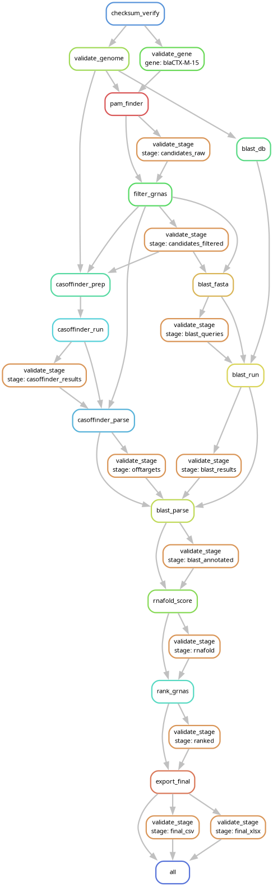

# Snakemake-CRISPR: Automated End-to-End CRISPR/Cas9 gRNA Design & Evaluation Pipeline

[](https://github.com/hasibulhossainsau-netizen/Let_it_flow/actions/workflows/ci.yml)

An automated, computational biology pipeline implemented in **Snakemake** to design, validate, and rank highly specific single-guide RNAs (sgRNAs) targeting antibiotic resistance genes, specifically focusing on the beta-lactamase gene **_blaCTX-M-15_**.

This pipeline integrates thermodynamic modeling, exact mismatch scanning, and BLAST cross-validation to minimize off-target risks across the bacterial genome while maximizing cutting efficiency. Every run is deterministic, checksum-verified, schema-validated, and logged in a structured, machine-readable format.

> **Upgrading from an earlier version?** See [REFACTORING_REPORT.md](REFACTORING_REPORT.md) for breaking changes and migration notes, including a **bug fix that changes RNAfold-derived scores**.

---

## 🔬 Scientific Context & Significance

Antimicrobial Resistance (AMR) is one of the greatest global health crises. The **_blaCTX-M-15_** gene encodes an Extended-Spectrum Beta-Lactamase (ESBL) enzyme, rendering enterobacterial pathogens resistant to crucial antibiotics like penicillins and cephalosporins.

This repository provides an automated solution to design **sequence-specific antimicrobials** via CRISPR-Cas9. By targeting and cleaving this specific gene sequence within the bacterial host, we can selectively knock out resistance or eliminate target plasmids, effectively resensitizing superbugs to conventional treatments.

---

## 🛠️ Pipeline Architecture



The workflow is modular and executed deterministically via Snakemake. Every intermediate is gated by a sanity check (the `validate_stage` boxes above) before the next step may consume it.

1. **Integrity & input validation:** `checksum_verify` checks every raw input against `data/raw/checksums.md5`; `validate_genome` / `validate_gene` audit FASTA syntax, the ACGT alphabet, record IDs and minimum lengths, with line/column-accurate error messages.
2. **PAM scanning:** scans both strands of the target gene and extracts 20-nt protospacers followed by a true SpCas9 `NGG` PAM (see the [PAM regex fix](REFACTORING_REPORT.md#4-bug-fix-the-pam-regex-matched-ggn-instead-of-ngg)).
3. **Biophysical filtering:** keeps spacers with GC between 40 % and 75 % and no homopolymer run of 5 or more; annotates PAM-proximal seed GC.
4. **Off-target mapping, Cas-OFFinder:** prep → run (`retries: 3`) → parse; allows up to `max_mismatches` (default 3).
5. **Cross-validation, BLASTn:** `makeblastdb` once, then FASTA → `blastn-short` (`retries: 3`) → parse, to flag partial homologies.
6. **Thermodynamic folding, RNAfold:** MFE of spacer + truncated sgRNA scaffold (`retries: 3`).
7. **Composite scoring & ranking:** weighted score (25 % spacer GC, 20 % seed GC, 25 % MFE, 30 % off-target penalty), verdicts, deterministic ordering (ties broken by `grna_id`).
8. **Export:** colour-coded Excel workbook and flat CSV per gene.

---

## 📈 Results Summary

The example in [`example_output/`](example_output/) holds 90 screened gRNAs for **_blaCTX-M-15_** (`blaCTX-M-15_gRNA_results_final.{csv,xlsx}`):

- **TOP CANDIDATES:** 89 — no exact off-target, optimal GC profile and accessible secondary structure.
- **CANDIDATES:** 1 — high specificity but a weaker biophysical score; experimental backup.
- **REJECTED:** 0 — no guide has an exact (0-mismatch) off-target in this genome.

> The example was regenerated end to end with the current pipeline against the public *K. pneumoniae* HS11286 genome (RefSeq `NC_016845.1` chromosome plus plasmids `NC_016838.1`, `NC_016839.1`, `NC_016840.1`, `NC_016841.1`, `NC_016846.1`, `NC_016847.1`, concatenated in that order). It therefore differs from earlier versions of this README (which used a genome that could not be reproduced) because of two bug fixes: [RNAfold parsing](REFACTORING_REPORT.md#3-bug-fix-rnafold-mfe-parsing) and the [PAM regex](REFACTORING_REPORT.md#4-bug-fix-the-pam-regex-matched-ggn-instead-of-ngg).

### Top Performing Candidate Profiles

| Rank | gRNA ID | Spacer Sequence (5' → 3') | PAM | Strand | Position (nt) | MFE (kcal/mol) | Efficiency Score | Selection Verdict |
| :---: | :--- | :--- | :---: | :---: | :---: | :---: | :---: | :---: |
| **1** | `DQ915955_+_406` | `GCTACAGTACAGCGATAACG` | TGG | `+` | 406 | -7.8 | **0.9350** | 🟢 TOP CANDIDATE |
| **2** | `DQ915955_-_801` | `TCCGCCGTTTGCGCATACAG` | CGG | `-` | 801 | -8.6 | **0.9282** | 🟢 TOP CANDIDATE |
| **3** | `DQ915955_-_336` | `CGAGGTGAAGTGGTATCACG` | CGG | `-` | 336 | -8.7 | **0.9275** | 🟢 TOP CANDIDATE |

---

## 🚀 Getting Started

### 1. Requirements

Linux (or WSL2) with **one** of:

| Option | You need | Best for |
| :--- | :--- | :--- |
| Conda environment | conda / mamba / micromamba | local work and development |
| Docker | Docker Engine | servers, CI, no conda |
| Apptainer / Singularity | Apptainer ≥ 1.0 | HPC clusters |

Everything is pinned in [`envs/crispr_pipeline.yaml`](envs/crispr_pipeline.yaml) (Python 3.11, pandas, numpy, BLAST+ 2.15, ViennaRNA 2.6.4, Cas-OFFinder 2.4.1, Snakemake 8.5.3, pytest). A fully resolved snapshot is in [`envs/crispr_pipeline.lock.yaml`](envs/crispr_pipeline.lock.yaml). See [docs/ENVIRONMENT.md](docs/ENVIRONMENT.md) for details, including how to export/lock the environment with `conda env export --no-builds`.

### 2. Install

```bash
git clone https://github.com/hasibulhossainsau-netizen/Let_it_flow.git
cd Let_it_flow

# Option A: conda / mamba / micromamba
conda env create -f envs/crispr_pipeline.yaml        # exact lock: envs/crispr_pipeline.lock.yaml
conda activate crispr_pipeline

# Option B: Docker
docker build -t crispr-pipeline:latest .

# Option C: Apptainer / Singularity (HPC)
apptainer build crispr-pipeline.sif Singularity.def
```

### 3. Provide your inputs

1. Put the **host genome** and **target gene** FASTA files in `data/raw/` and point `config/config.yaml` at them (`genome_fasta`, `target_gene_fasta`, or the multi-gene `genes:` block).
   The genome is not shipped (it is large and git-ignored). For *K. pneumoniae* HS11286, for example, fetch it from NCBI (chromosome `NC_016845.1` plus its plasmids).
2. Record their checksums. The pipeline refuses to run on unlisted or modified inputs:

   ```bash
   md5sum data/raw/<your_genome>.fasta >> data/raw/checksums.md5
   ```

### 4. Run

```bash
snakemake --cores 4 --dry-run         # inspect the job graph
snakemake --cores 4                   # run (tools from the active environment)
snakemake --cores 4 --use-conda       # or let Snakemake build the pinned env per rule

# Docker (bind-mount the project so data/, results/ and logs/ stay on the host)
docker run --rm -v "$PWD":/pipeline -w /pipeline --user "$(id -u):$(id -g)" \
    crispr-pipeline:latest snakemake --cores 4

# Apptainer
apptainer exec --bind "$PWD":/pipeline --pwd /pipeline crispr-pipeline.sif snakemake --cores 4
```

> With Snakemake 8, `--use-conda` needs `mamba` or `--conda-frontend conda`.
> Inside the container images the tools are already installed: do **not** pass `--use-conda`.

### 5. Where things go

| Path | Content |
| :--- | :--- |
| `results/<gene>_final.csv` / `.xlsx` | final ranked table / colour-coded workbook |
| `data/processed/<gene>/` | per-gene intermediates (candidates, Cas-OFFinder / BLAST output, scores) |
| `logs/<rule>/<gene>.log` | JSON-lines run log + raw tool stderr (global rules: `all.log`) |
| `logs/flags/` | sentinel files for checksum / validation / sanity checks |

Each log starts with a record of the exact command, host and tool version, and every script logs its parameters, seed, library versions and input-file statistics. Inspect with e.g. `grep '"level": "ERROR"' logs/*/*.log`.

---

## ⚙️ Configuration

All tunables live in [`config/config.yaml`](config/config.yaml) and are validated against [`config/schema.yaml`](config/schema.yaml) (unknown keys and out-of-range values fail early with the offending path). Omitted sections fall back to schema defaults.

| Key | Purpose |
| :--- | :--- |
| `genome_fasta`, `target_gene_fasta` | input FASTA files |
| `genes: {name: fasta}` | optional multi-gene mode; each name becomes a `{gene}` wildcard and `results/<name>_final.*` |
| `checksums_file` | MD5 manifest that must list the genome and every gene |
| `max_mismatches`, `threads`, `seed` | Cas-OFFinder mismatches, parallelism, RNG seed (default 42) |
| `tools.*` | Cas-OFFinder device (`C`/`G`), RNAfold timeout |
| `validation.*` | minimum gene/genome length, tolerated ambiguity fraction in the genome |
| `guide.*` | spacer length, PAM regex, GC window, homopolymer limit, seed definition |
| `blast.*` | BLAST task/word size/identity and parsing thresholds |
| `structure.*` | sgRNA scaffold, MFE floor |
| `scoring.*` | component weights (must sum to 1.0), GC curve, off-target tiers, verdict thresholds |
| `export.*` | Excel sheet name, columns, colours |

**Multiple genes:**

```yaml
genes:
  blaCTX-M-15: "data/raw/blaCTX-M-15_ref.fasta"
  blaNDM-1:    "data/raw/blaNDM-1_ref.fasta"
```

---

## 🧪 Testing

```bash
pytest tests/unit tests/test_toy_fixtures.py    # fast unit tests (~1 s)
pytest tests/integration                        # toy end-to-end run: snakemake --cores 1 --use-conda
GRNA_IT_USE_CONDA=0 pytest tests                # everything, using tools already on PATH (e.g. in Docker)
```

* **Unit tests** cover the scoring functions, FASTA parsing and input validation, config/schema validation, the RNAfold output parser (including the padded-MFE regression), ranking determinism, the output sanity checks and PAM extraction (the `NGG` fix).
* **Integration test** ([tests/integration](tests/integration)) runs the real workflow on a synthetic **1 kb genome with an embedded 100 bp gene** ([fixtures](tests/data/toy)), then checks the outputs, structured logs, tool versions, idempotence (second run is a no-op) and that a corrupted input is caught by the checksum rule. The fixtures are regenerated deterministically with `python tests/make_toy_fixtures.py`.
* The rule environment is cached in `~/.cache/crispr_pipeline_tests/conda` (override with `GRNA_CONDA_PREFIX`).
* **CI** ([.github/workflows/ci.yml](.github/workflows/ci.yml)) runs, on every push to `main` and every pull request: unit tests, config validation, a workflow dry-run, the integration test with `--use-conda`, and the full test-suite inside the Docker image.

---

## 🧩 How to Extend

The code is organised so that most changes touch one place. Conventions every script follows: parse args → `load_config` → `init_script(...)` (seeds RNGs, logs parameters, versions, input stats) → work → `run_main(main, name)` (structured start/finish and crash logging). Rules call scripts through `scripts/run_guarded.sh`, which writes `logs/<rule>/<gene>.log`.

### Target another gene or host
Add the FASTA files, list them under `genes:` in the config, add their MD5 to `data/raw/checksums.md5`, and run `snakemake`. Each gene gets its own `data/processed/<gene>/` and `results/<gene>_final.*`; the genome-level steps (`blast_db`, genome validation) run once. To use a different Cas9 variant or PAM, edit `guide.pam_regex` (group 1 must capture the spacer; the PAM is the `guide.pam_length` bases right after it), `guide.pam_length` and `guide.cas_offinder_pam`, and keep the `{20}` in the regex equal to `guide.spacer_length`. For example, SpCas9 `NGG` is `(?=(.{20}).GG)`.

### Change the scoring or filters
Edit `scoring.*` / `guide.*` in the config; the schema rejects invalid values and weights that do not sum to 1. To change the *shape* of a score, edit the pure function in [`scripts/scoring_metrics.py`](scripts/scoring_metrics.py) and extend [`tests/unit/test_scoring_metrics.py`](tests/unit/test_scoring_metrics.py).

### Add a report column
Compute it in `scripts/rank_candidates.py` (or an earlier step), append its name to `export.columns` in the config, and add it to the relevant stage in `scripts/validate_outputs.py` so it is checked for NaN.

### Swap in another RNA-structure predictor *(plugin point, wired in)*
1. Subclass `StructurePredictor` in `interfaces/` (see [`interfaces/rnafold.py`](interfaces/rnafold.py)): implement `version()` and `predict(rna_seq) -> (mfe, dot_bracket)`; raise `RuntimeError` on failure.
2. Register it in `STRUCTURE_PREDICTORS` in [`interfaces/__init__.py`](interfaces/__init__.py).
3. Allow the name in `tools.structure_predictor` in [`config/schema.yaml`](config/schema.yaml), then select it in the config.
4. Add the binary to `envs/crispr_pipeline.yaml` (and regenerate the lock file), and unit-test the output parser with a stub executable as in [`tests/unit/test_rnafold_parser.py`](tests/unit/test_rnafold_parser.py).

### Add another off-target search tool
`OffTargetSearcher` classes exist in `interfaces/` (Cas-OFFinder, BLASTn), but **the Snakefile does not call them yet**: it runs the Cas-OFFinder and BLAST rule chains directly, and `tools.off_target_searchers` currently has no effect. To add a tool today, follow the existing pattern as three rules: **prep → run (`retries: 3`, `conda:`, `resources:`, `log:`) → parse**, have the parser merge its counts into the per-gene CSV, and gate each new file with a `validate_stage` check (below). Making the workflow dispatch on `tools.off_target_searchers` is a natural next refactor.

### Add a sanity check for a new intermediate
1. Add the stage's required columns to `CSV_STAGES` (or a text format to `TEXT_STAGES`) in `scripts/validate_outputs.py`.
2. Add the file to the `CHECKED` dict and the stage name to `wildcard_constraints` in `workflow/Snakefile`.
3. Make the consuming rule take `ok("<stage>")` as an input, so a bad file stops the DAG.
4. Add a case to `tests/unit/test_validate_outputs.py`.

### Add a workflow step
Copy a neighbouring rule: log path `logs/<rule>/{gene}.log`, `threads:`, `resources:` (`mem_mb`, `runtime`, with an `attempt`-scaled lambda for external tools), `conda: ENV`, `retries: 3` for external tools, and `shell: "{GUARD} {log} ..."`. Put logic in a script under `scripts/` that uses `init_script` / `run_main`, not inline shell.

### Run something new in CI
Unit tests go in `tests/unit/`; anything needing the whole workflow can reuse `tests/toy_workdir.py` (`build_workdir(dest)`), which lays out a runnable project around the toy fixtures.

---

## 📂 Repository Structure

```
├── config/
│   ├── config.yaml                 # all tunable parameters and input paths
│   └── schema.yaml                 # JSON-schema validation + defaults for the config
├── workflow/
│   └── Snakefile                   # atomic rules, {gene} wildcard, retries, sanity gates
├── scripts/
│   ├── 01_validate_inputs.py       # FASTA syntax / alphabet / length audit
│   ├── 02_pam_finder.py            # protospacer & PAM extraction
│   ├── 02b_inspect_candidates.py   # pre-filter selection
│   ├── 03_casoffinder_prep.py      # Cas-OFFinder input
│   ├── 04_parse_offtargets.py      # Cas-OFFinder hits -> counts
│   ├── 04b_generate_fasta.py       # BLAST query FASTA
│   ├── 05_parse_blast.py           # BLAST hits -> counts
│   ├── 06_rnafold_score.py         # RNAfold MFE via the StructurePredictor plugin
│   ├── rank_candidates.py          # composite scoring, verdicts, deterministic ranking
│   ├── export_final.py             # CSV + Excel export
│   ├── scoring_metrics.py          # pure scoring functions
│   ├── report_formatting.py        # openpyxl styling
│   ├── validate_outputs.py         # per-stage sanity checks
│   ├── verify_checksums.py         # MD5 manifest verification
│   ├── run_guarded.sh              # fail-fast wrapper: logs, exit codes, tool versions
│   └── utils/                      # config, fasta, seq, dataframe, runtime (logging + seeds)
├── interfaces/                     # pluggable tool back ends (RNAfold, Cas-OFFinder, BLASTn)
├── envs/
│   ├── crispr_pipeline.yaml        # pinned environment (single source of truth)
│   └── crispr_pipeline.lock.yaml   # fully resolved snapshot
├── tests/                          # unit tests, toy fixtures, integration test
├── docs/ENVIRONMENT.md             # environments, containers, locking
├── Dockerfile  Singularity.def     # container images
├── .github/workflows/ci.yml        # CI
├── data/raw/                       # inputs + checksums.md5
├── example_output/                 # reference results and workflow DAG
└── REFACTORING_REPORT.md           # architecture changes, breaking changes, migration
```

---

## 🎓 Academic Application & Reusability

To target any other antibiotic resistance gene (e.g., *NDM-1*, *mcr-1*) or a different bacterial host, update the paths and parameters in `config/config.yaml` (see **How to Extend**). Running `snakemake` regenerates a dedicated, production-ready Excel evaluation report for each target.
